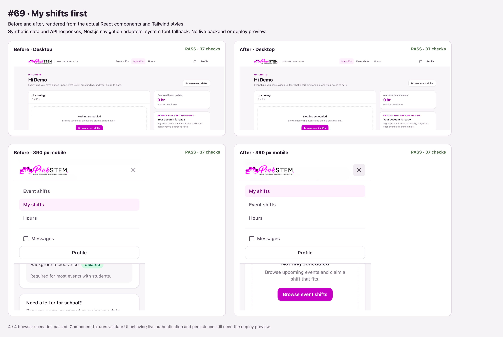

# My shifts navigation order

My shifts appears before event browsing for signed-in participants in both desktop navigation and the mobile menu. Admin and signed-out navigation retain their existing links.

Type checking, lint, formatting, and eight rendered navigation states passed. The browser comparison ran 37 assertions in each of four before/after desktop/mobile fixtures, covering menu interactions, roles, event browsing, and organizer messaging.

The screenshot uses the actual components with synthetic API responses, Next.js navigation adapters, and a system font fallback. It does not verify live authentication or persistence. The production build could not download Montserrat from Google Fonts in the restricted environment; confirm the build and signed-in navigation in the deploy preview.
