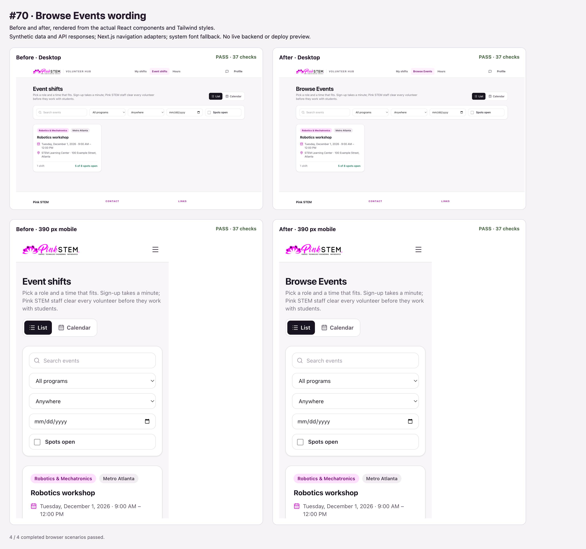

# Browse Events wording

The event listing, navigation, dashboard actions, footer, missing-event action, and cancellation email use Browse Events. All destinations and signup behavior stay the same.

This branch follows the My shifts navigation change; its diff against that branch contains only the wording updates and this verification evidence. Rendered navigation and HTML/plain-text cancellation email checks passed, including the unchanged listing URL. Type checking, lint, and formatting passed. Each of four before/after desktop/mobile browser fixtures passed 37 assertions, including list/calendar switching.

The browser fixtures use the actual components with synthetic API responses and Next.js navigation adapters. Live authentication, persistence, email delivery, and the deploy preview were not tested. The production build requires downloading Montserrat from Google Fonts, which this environment could not reach.
