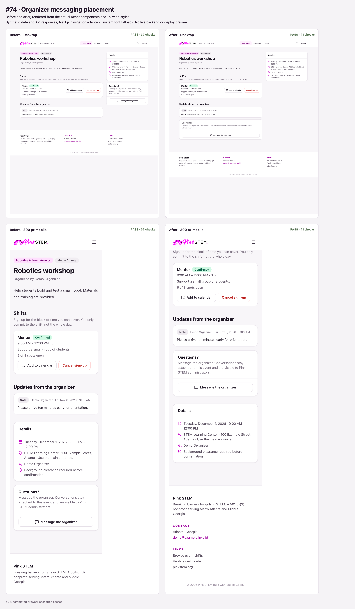

# Organizer messaging placement

The existing Questions card follows organizer updates in the main event section, including an empty updates feed. It no longer appears in the sidebar. The eligibility check, privacy disclosure, dialog, and submission flow are unchanged.

Type checking, lint, formatting, and component checks across 56 role/signup/update combinations passed. Handler checks covered opening the dialog, the privacy notice, successful submission/navigation, failed submission retaining the message, and disabled Send during loading. Before-change browser fixtures passed 37 assertions; after-change fixtures passed 41 assertions at both desktop and mobile widths.

These fixtures render the actual components with synthetic API responses and Next.js navigation adapters. Live authentication, persistence, and the deploy preview were not tested. The existing Montserrat font download prevented the local production build in the restricted environment.
